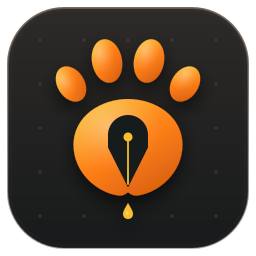
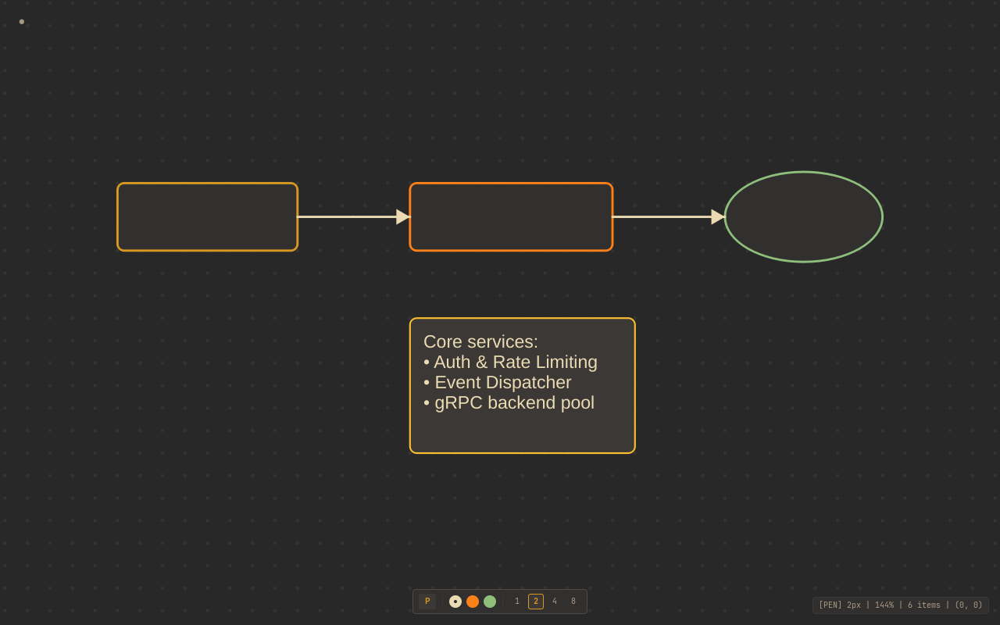

<p align="center">
  
</p>

<h1 align="center">Paws 🐾</h1>

<p align="center">
  <strong>Complex capability underneath, extremely simple interface on top.</strong><br>
  <em>A serious, local-first visual thinking workspace built for Linux developers and minimalist thinkers.</em>
</p>



---

## 💡 The Story

I needed a personal visual thinking tool—a board for technical sketches, architecture diagrams, flowcharts, and creative brainstorming—that didn't feel like a bloated SaaS web app. I wanted something fast, distraction-free, and respectful of my workspace:
- **Zero bloat**: No subscriptions, no cloud sync lag, no giant floating toolbars getting in the way of thought.
- **My preference themes**: Native support for beloved developer palettes like Gruvbox, Catppuccin, Everforest, Nord, Tokyo Night, Dracula, and VS Code.
- **Custom keyboard-first workflow**: Neovim-style navigation, fast keybindings, quick pen sizes (`1`–`4`), a persistent laser pointer (`K`), and Zen mode (`Z`).
- **Completely organized & local-first**: Human-readable JSON documents saved locally on disk, with instant clipboard exports and vector output.

So I **vibe-coded this end-to-end with Gemini 3.8 Flash High**, delegating the heavy technical lifting under the hood—from C++ graphics engineering and spline mathematics to high-FPS rendering pipelines and automated testing—while keeping the user interface clean, intentional, and minimal.

---

## ✨ Features

### 🖋️ Butter-Smooth Freehand Drawing
- **Midpoint Quadratic Bézier Spline (`quadTo`)**: Mathematical $C^1$ continuity that completely eliminates kinks, loops, and self-intersections. Curves flow with organic grace.
- **5-Point Binomial Gaussian Stream Smoothing**: Real-time jitter filter ($\frac{1}{16}, \frac{4}{16}, \frac{6}{16}, \frac{4}{16}, \frac{1}{16}$) removes mouse hand tremor and sensor noise with zero visual lag.
- **Live Stream Preview**: What you see while drawing is identical to what is committed on release—zero stroke popping or jarring shifts.
- **Hardware Stylus & Pressure Support**: Captures hardware pressure levels from drawing tablets (Wacom, Apple Pencil, Huion).
- **Hold-to-Straighten**: Hold your stroke still for a split second to automatically snap messy lines into straight vectors.

### 🔦 Minimalist Laser Pointer (`K`)
- **Stays on screen while drawing**: Multiple strokes remain 100% visible while presenting or circling diagrams.
- **Smooth fadeout on release**: Once released, strokes linger for 1.2 seconds, then smoothly dissolve over 0.8 seconds.
- **Multi-stroke support**: Circle or annotate multiple areas without connecting lines.
- **Clean aesthetic**: Rendered in your selected theme color with zero distracting glow.

### 🎨 Design Token Theme System
- Full semantic palette support across 8 iconic theme families:
  - **Gruvbox** (Dark Soft, Dark Medium, Dark Hard)
  - **Catppuccin** (Mocha, Macchiato, Frappe, Latte)
  - **Everforest** (Dark Soft, Dark Medium, Dark Hard)
  - **Dracula**
  - **Nord**
  - **Tokyo Night**
  - **VS Code** (Dark Modern, Dark+)
  - **IntelliJ IDEA** (Darcula, Modern Dark Island)
- Design tokens dynamically style the canvas, grid, surfaces, borders, text, notes, and strokes.

### 📐 Diagrams & Smart Connectors
- **Smart Connectors (`X`)**: Cardinal anchor points (Top, Right, Bottom, Left) that snap to shapes and dynamically route and adapt as shapes move.
- **Geometric Shapes**: Rectangles (`R`), Ellipses (`C`), Straight Lines (`L`), and Directional Arrows (`A`), with `Shift` constraints for perfect 1:1 squares, circles, and 45° angles.
- **Highlighter (`M`)**: Semi-transparent, wide chisel highlighter with flat caps and rounded joins.
- **Markdown / Text (`T`)**: Clean inline canvas typography with auto-wrapping bounding boxes.
- **Sticky Notes (`N`)**: Color-matched technical note cards with automatic word wrapping.

### ⚡ Blazing Fast Architecture
- **150x Faster Batched Rendering**: Dot grids rendered in a single vectorized `painter->drawPoints(...)` batch call, replacing thousands of per-frame ellipse allocations.
- **Viewport Culling**: Off-screen elements are culled before rasterization, sustaining silky 120Hz/144Hz+ frame rates on 4K monitors.
- **Local-First JSON**: Versioned, human-readable format with atomic disk writing and crash recovery.
- **Direct Clipboard Snapshot (`Ctrl+Shift+C`)**: Instantly captures the canvas or active selection directly to your system clipboard for pasting into chat, Slack, or GitHub issues.
- **High-Fidelity Exports**: High-resolution PNG (transparent or canvas background), vector SVG, and vector PDF.

---

## ⌨️ User Manual & Shortcuts

Paws is built keyboard-first. Global shortcuts never conflict with text inputs or modal dialogs.

### Tools
| Shortcut | Tool | Description |
|---|---|---|
| `P` | **Pen** | Natural freehand ink pen |
| `M` | **Highlighter** | Translucent marker for annotations |
| `K` | **Laser Pointer** | Temporary presentation pointer that stays and fades |
| `V` | **Select** | Click to select, drag bounding box, resize with handles |
| `E` | **Eraser** | Point-and-stroke eraser with fade preview |
| `R` | **Rectangle** | Draw rectangles (`Shift` for square) |
| `C` | **Ellipse** | Draw ellipses (`Shift` for circle) |
| `L` | **Line** | Two-point straight line |
| `A` | **Arrow** | Directional vector arrow |
| `X` | **Connector** | Smart connector between shape cardinal points |
| `T` | **Text** | Click canvas to place editable text |
| `N` | **Sticky Note** | Click to place technical note card |
| `H` | **Hand** | Pan the canvas |

### Pen & Stroke Tuning
| Shortcut | Action |
|---|---|
| `1` | Set Pen Size to **3px** |
| `2` | Set Pen Size to **4px** |
| `3` | Set Pen Size to **5px** |
| `4` | Set Pen Size to **6px** |
| `Tab` | Cycle to Next Palette Color |
| `Shift` + `Tab` | Cycle to Previous Palette Color |
| `Z` | Toggle **Zen Mode** (distraction-free canvas) |

### Navigation & Canvas
| Shortcut | Action |
|---|---|
| `Space` + Drag | Temporary Pan |
| `Ctrl` + Mouse Wheel | Smooth Zoom anchored to cursor position |
| `Ctrl` + `=` | Zoom In |
| `Ctrl` + `-` | Zoom Out |
| `Ctrl` + `0` | Reset Viewport (100% zoom, center) |
| `Shift` + `1` | Zoom to Fit all canvas elements |
| `Ctrl` + `'` | Cycle Grid (Dots, Lines, Crosses, None) |

### Editing & Clipboard
| Shortcut | Action |
|---|---|
| `Ctrl` + `Z` | Undo |
| `Ctrl` + `Shift` + `Z` | Redo |
| `Ctrl` + `A` | Select All elements |
| `Ctrl` + `D` | Duplicate selection |
| `Delete` / `Backspace` | Delete selected elements |
| `Ctrl` + `G` | Group selected elements |
| `Ctrl` + `Shift` + `G` | Ungroup selected elements |
| `]` / `[` | Bring Forward / Send Backward |
| `Shift` + `]` / `Shift` + `[` | Bring to Front / Send to Back |
| `Ctrl` + `Shift` + `C` | **Copy Snapshot to System Clipboard** |
| `Esc` | Clear selection / Cancel current operation |

### File & Export
| Shortcut | Action |
|---|---|
| `Ctrl` + `N` | New Document |
| `Ctrl` + `O` | Open File |
| `Ctrl` + `S` | Save Document |
| `Ctrl` + `Shift` + `S` | Save Document As... |
| `Ctrl` + `E` | Export (PNG / SVG / PDF) |
| `,` | Open Settings Dialog |

---

## 🖥️ Headless CLI Pipeline

Paws integrates cleanly with terminal scripts and pipelines:

```bash
# Open an existing document or create a new file
paws path/to/diagram.paws

# Headless batch export to PNG, SVG, or PDF (no display required)
paws --export diagram.png path/to/diagram.paws
paws --export architecture.svg path/to/diagram.paws
paws --export spec.pdf path/to/diagram.paws
```

---

## 🛠️ Installation & Building

### Prerequisites (Arch Linux & Omarchy)

Install the required Qt 6 development libraries and tools:
```bash
sudo pacman -S qmake6 qt6-base qt6-declarative qt6-svg qt6-wayland gcc make
```

### Build & Test

```bash
# Clone the repository
git clone https://github.com/smk-rifat/paws.git
cd paws

# 1. Compile the C++ binary
./bin/build

# 2. Run the automated test suite (29 tests)
./bin/test

# 3. Install Arch Linux package into your desktop launcher
./bin/install
```

### User Configuration

User preferences, window geometry, and custom keybinding overrides are stored in standard XDG paths:
- Config: `~/.config/paws/settings.json`
- Custom Shortcuts: `~/.config/paws/shortcuts.json`
- Autosave recovery: `~/.local/state/paws/`

---

## 📄 License

MIT License. Copyright (c) 2026 smk.rifat and Paws contributors.
Portions copyright (c) David Heinemeier Hansson (Omacut/Monologue design patterns).
